# Architecture

The problem Cage solves is not "converting Excel to JSON", but: **how to reliably compile the scattered, heterogeneous, human-oriented configuration data produced during game development into configuration assets that are validated, deterministically built, and ready for direct consumption by different runtimes.**

Core flow:

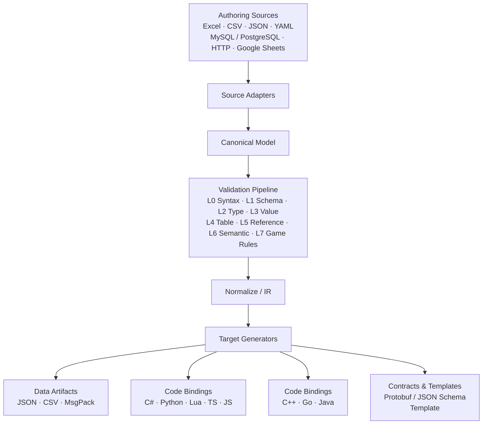

All 14 target kinds are implemented: JSON / CSV / MsgPack data artifacts; C# / Python /
Lua / TypeScript / JavaScript / C++ / Go / Java code bindings; Protobuf
Schema definition generation (`.proto`, no wire encoding); FlatBuffers definition
generation (`.fbs`, no wire encoding) and JSON Schema; and the Template target
(user-defined Tera templates).

## Why Cage Is Needed

In a game project, configuration typically serves all of the following at once:

- Designers
- Programmers
- Client
- Server
- Toolchain
- CI/CD
- Test environments
- Operations

Different roles need different representations. For example, the same Item configuration:

| Role | Representation Needed |
| ---- | -------------------- |
| Designers | Excel |
| Client | JSON / CSV / C# |
| Server | JSON / CSV / Lua / Python |
| Tools | JSON / SQLite / Binary |

Without a unified configuration build system, a project easily degenerates into:

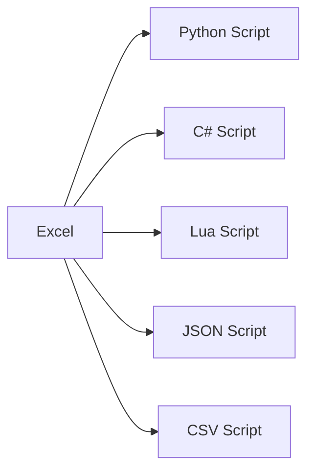

Then each script:

- Parses on its own
- Converts on its own
- Validates on its own
- Handles default values on its own
- Handles references on its own
- Reports errors on its own

This eventually produces several problems:

1. Different outputs may produce different results.
2. Validation logic is scattered across different scripts.
3. Cross-table references cannot be validated in one place.
4. Configuration errors only surface when the game actually runs.
5. Changing one field requires changing multiple converters.
6. CI gets no unified configuration quality gate.
7. Configuration never forms traceable, reproducible build artifacts.

Cage's goal is to unify this chain.

## Six Core Concepts

Cage divides the configuration system into six core concepts:

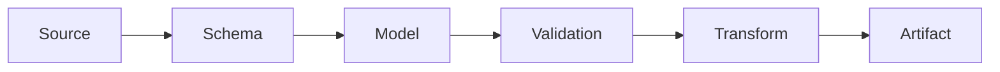

### Source

Where configuration enters from, for example Excel, CSV, JSON, YAML; already extended with the MySQL / PostgreSQL, HTTP API, and Google Sheets remote sources and the `registry:` source root, with XML, TOML, SQLite, and more to follow.

A Source is only responsible for:

> **Reading external data into Cage.**

It should not be responsible for business validation. See the [Source section](/en/source).

### Schema

Defines the structure and constraints of configuration, for example:

```yaml
tables:
  Item:
    name: Item
    primary_key: [id]
    fields:
      id: { name: id, type: { kind: UInt32 }, required: true }
      title: { name: title, type: { kind: String }, required: true }
      price: { name: price, type: { kind: UInt32 }, min: 0 }
      type: { name: type, type: { kind: Enum, value: ItemType } }

enums:
  ItemType:
    name: ItemType
    values:
      - { name: Weapon, value: 1 }
      - { name: Armor, value: 2 }
      - { name: Consumable, value: 3 }
```

Schema defines: fields, types, required fields, default values, ranges, enums, arrays, objects, uniqueness, references, output information (this is the actual wire format; for the full DSL see the [Schema section](/en/schema)).

### Canonical Model

Every Source should flow into one unified intermediate model:

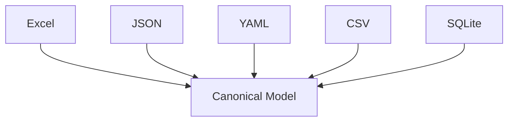

The Canonical Model should not simply be equated with JSON. Recommended basic types:
`Null` / `Bool` / `Int` / `UInt` / `Float` / `String` / `Bytes` /
`Array` / `Object`.

It also carries four kinds of annotation information: Source Location (source
position), Schema Information (structure), Type Information (typing), and
Metadata.

This makes it possible to:

```text
monster.xlsx
Sheet: Monster
Row: 27
Column: DropItemID
```

pinpoint the exact location inside error messages.

## Compiler Core: The Boundaries of Eight Concepts (Finalized in v0.3)

Consensus: Cage's biggest risk is not a lack of features but blurry boundaries in the compiler's core model — once the eight concepts `Schema / Canonical Model / IR / Validation Context / Dependency Graph / Profile / Snapshot / Manifest` are stable, Excel/CSV/JSON/YAML and C#/Lua/C++/Python/Protobuf are all just plugins. This chapter locks down where each concept belongs and its hard deadline; the plugin model below and all Targets work on top of this table.

### Concept Boundary Table

| Concept | Definition | Backing Types | Production → Consumption | Boundary Prohibitions |
| --- | --- | --- | --- | --- |
| Schema | The structural and constraint definition of configuration (compile-time input) | `Schema` / `ValidatedSchema` (cage-core::schema) | Written by users → consumed by Validation and Targets | Never reads data files; never carries runtime values |
| Canonical Model | The semantic model of data in Cage's world | `Value` / `TypedValue` / `Document` (cage-core::value, including SourceLocation) | Produced by Sources → consumed by Validation / Normalize / Targets | Not identified with any file format; Sources only read the data in, Targets only read it |
| IR | The normalized Canonical. v0.3 boundary decision: isomorphic to Canonical, no separate type | Just the Canonical (normalized `Document` + `Schema`) | Produced by Normalize → consumed by Targets | Targets must not read Source files back; no re-validation at the IR stage |
| Validation Context | The cursor and live state while validation executes | `ValidationContext` (current_table / current_row / current_field / schema…) | Produced by Validation → consumed by Diagnostics | Validation produces no artifacts and modifies no data; Targets do not re-validate |
| Dependency Graph | The topology of cross-table references and incremental planning | `DependencyGraph` / `IncrementalPlanner` (cage-core::reference) | Graph built from schema reference declarations (`from_schema`) → consumed jointly by L5 validation and incremental builds | The graph is a compilation result, not runtime data |
| Profile | A trimmed view aimed at consumers | `BuildProfile` (cage-core::manifest) + profile filtering | Configured by users → trims Schema + Document → Validation / Target | Filtering is a starting point, not the destination: for where the semantics land, see the gap table |
| Manifest | The ledger and input fingerprints of build artifacts | `BuildManifest` / `ArtifactInfo` (cage-core::manifest) | Produced by ManifestGenerator → consumed by verify / incremental builds / deployment / rollback | Only records, never generates; written to disk together with artifacts and verified together with them |
| Snapshot | An independently loadable configuration snapshot (implemented in D5) | `snapshot_files` / `verify_snapshot` / `load` (cage-core::snapshot) | Produced by builds → loaded and verified at server / client startup | Snapshots carry their own verification information and do not depend on the build machine |

### Why IR Does Not Get a Separate Type (v0.3 Decision)

The reviewed prototype imagined IR ≈ `CompiledItemTable { schema_id, table_id, fields, values,
references, normalized_types, visibility, dependencies }`. Compared with the current state:

- normalize (cage-core/src/normalize/mod.rs: `normalize_document` /
  `normalize_typed_value` / `normalize_value`) is a pure Canonical → Canonical
  transformation, and its output is still the Document / TypedValue / Value types;
- the entry point of all 14 targets is either `(Schema, Document)` (data targets) or
  `(Schema, schema_hash)` (code targets — types and metadata all come from the
  Schema, and data takes no part in code generation). The target side already
  consumes from an IR perspective and structurally satisfies the "must not read
  Source" rule.

Splitting out a separate IR type at this stage would only introduce duplicate shapes and a needless extra conversion/testing surface. Boundary decision: IR is isomorphic to Canonical and is expressed as (normalized Document, Schema). **When to split it out later**: once the shapes of the validation side and the artifact side start to diverge (per-profile trimming becomes baked in, visibility gets folded, artifacts need derived shapes precomputed at compile time), converge on a Compiled IR — the split point is already reserved, and no up-front design is being done.

### Current Status and Gaps (Concept-by-Concept Review, 2026-10)

| Concept | Current Status | Gap / Next Step |
| --- | --- | --- |
| Schema | Implemented: 19 field types (including Map), references, uniqueness constraints, field-level `targets` visibility | — |
| Canonical Model | Implemented: the full type set in value.rs + SourceLocation | — |
| IR | Boundary decided (see above) | Split out a Compiled IR once a need for derived shapes appears |
| Validation Context | Implemented: validation/mod.rs (schema / document / diagnostics / max_level / profile / reference_cache / warnings_as_errors) | — |
| Dependency Graph | Implemented and wired in: reference/mod.rs `DependencyGraph` (cycle detection / topology) + `IncrementalPlanner`; the CLI build path is wired for real, the second incremental layer uses table hashes + dependency propagation to rebuild only affected tables, and the manifest keeps a `dependencies` / `table_hashes` ledger (D2) | Incrementally deleting a table falls back to a full build (deletion semantics do not propagate along edges) |
| Profile | Implemented (D3 semantics): panel filtering at both the table and field levels trims the Schema and the Document artifact view; validation runs against the **full** schema/document (a profile only trims the artifact view and grants no exemption from data validation); ValidationContext carries the profile, and structurally indispensable fields (required with no default / primary keys / uniqueness constraints / reference targets) that a profile hides raise an E9006 conflict instead of being silently filtered out | Trimming of optional fields preserves legal-view semantics; dropping a whole table is table-level visibility semantics |
| Environment | Implemented (§48 per-environment validation): the table-level Schema `env_overrides` declares "environment name → field → constraint patch" (partial patches, whole-value replacement, types cannot be overridden); `--env` is resolved into one ordinary Schema before validation/generation (zero changes to validators and code generation); environment names are self-declared by the Schema (the union of declared_envs), the manifest records `environment`, schema_hash/build_id rotate with the environment, and the incremental guard fails on environment mismatch | A lint for bad overrides in non-selected environments (needs a new E code) and environment-aware snapshot / registry publish packaging are left for later |
| Manifest | Implemented (D4 + third incremental layer + environments §48): 13 top-level fields (project / profile / environment / cage_version / generator_version / build_id / schema_hash / source_hash / content_hash / dependencies / table_hashes / targets / artifacts; `environment` takes its default on baseline builds) | — |
| Snapshot | Implemented (D5): `cage snapshot` packages the profile view + `--verify` validation (`--env` for environment-aware packaging: directory name `<profile>-<env>-<build_id[..12]>`, and the in-package manifest records the environment); the deterministic `snapshot/<profile>[-<env>]-<build_id[..12]>` directory (a per-file ledger of manifest / schema.json / data / generated / HASHES); core provides the verify/load server entry points | The deletion/rollback policy (managing multiple coexisting snapshots) belongs to the Registry phase — R1–R4 are implemented (`cage registry` local publish/list + the `registry:` source with schema_path resolution + `[dependencies]` version pins + read-only remote http(s) resolution, where each entry is a self-verifying snapshot + verify audits the whole registry / gc with a rolling window / remove for explicit removal and republication); §47 A-series distribution is implemented (export of deterministic tar bundles / import into the registry through a trust gate / push straight to an http(s) remote root, with five E21xx codes wired in) |

### Review Comparison Corrections (External Review, 2026-10)

| Review Item | Review Rating (out of 5) | Code Verification Conclusion |
| --- | --- | --- |
| IR | 3 | Folded into Canonical by the boundary decision; see "Why IR Does Not Get a Separate Type" |
| Dependency Graph | 2 | Closed (D2): core + build wiring + the second incremental layer + the manifest ledger (dependencies / table hashes) |
| Incremental Build | 2 | Closed (D2): layer 1 skips whole rounds + layer 2 uses dependency propagation to rebuild only affected tables (bytes identical to a full build, manifest converges); deleting a table falls back to a full build |
| Snapshot | 2 | Closed (D5): `cage snapshot` packaging + `--verify` validation + core verify/load server entry points; deterministic directory names (build_id fingerprint, date-based naming abandoned) |
| Profile | 4 | Closed (D3): filtering + E9006 conflict semantics + a profile-aware validation context; validation covers the full data set, and a profile only trims the artifact view |
| Manifest | — | Suggested rating (D4): build_id / generator_version / dependencies / table_hashes are in place, and a deterministic 24-character blake3 fingerprint prefix replaces timestamps |
| Diagnostics | 5 | Confirmed: the full L0-L7 error-code families, row-level locations + hints, E1601 end to end |
| Deterministic Build | 5 | Confirmed: byte-identical output for the same inputs is locked in by golden tests |

## Plugin Model

Cage's core should stay as stable as possible:

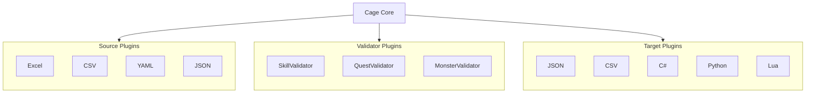

This way, third parties can extend Cage without modifying the Core.

## Project Structure (Rust Implementation)

Cage is implemented in Rust and organized as a Cargo workspace of multiple crates; the core and each input/output plugin are independent of one another, with dependencies pointing one way toward `cage-core`:

```text
cage/
├── Cargo.toml               # workspace 根
├── crates/
│   ├── cage-core/           # Canonical Model / Schema / Diagnostics /
│   │   └── src/             # Validation / Reference / Normalize / Manifest
│   │       ├── value/           # Canonical Model（Value + Source Location）
│   │       ├── schema/          # Schema 定义与解析
│   │       ├── diagnostics/     # 诊断框架（错误码 / 定位 / 渲染）
│   │       ├── error/           # 错误码全表（E0xxx~E99xx 分族常量）
│   │       ├── validation/      # L0-L7 验证流水线
│   │       ├── reference/       # 跨配置引用 + DependencyGraph / IncrementalPlanner
│   │       ├── normalize/       # 归一化
│   │       ├── manifest/        # Build Manifest
│   │       ├── snapshot/        # Configuration Snapshot（打包 / 校验 / 加载）
│   │       ├── edit/            # Schema ↔ 编辑器交换模型（W1）
│   │       ├── registry.rs      # Configuration Registry（发布 / 解析 / 审计，R1-R4；bundle 导出导入 + http(s) 直推，§47 A 系列）
│   │       ├── migrate/         # 声明式数据迁移（规则模型 + 执行器 + 回验，M 系列，design §46）
│   │       └── remote.rs        # Remote Source 共享取数 / 重试 / 缓存键（§45；http_put 直推写通道，§47 A3）
│   ├── cage-source-excel/   # Excel 输入源（calamine）
│   ├── cage-source-csv/     # CSV 输入源
│   ├── cage-source-json/    # JSON 输入源
│   ├── cage-source-http/    # HTTP API 输入源（S1，design §45）
│   ├── cage-source-db/      # MySQL / PostgreSQL 输入源（S2，design §45：SELECT 白名单 + 会话只读 + 行集 → canonical JSON 落缓存）
│   ├── cage-source-sheets/  # Google Sheets 输入源（S3，design §45：values UNFORMATTED_VALUE + 首行表头 + 形状门 E1903）
│   ├── cage-source-yaml/    # YAML 输入源
│   ├── cage-source-msgpack/ # MessagePack 输入源（registry 回灌：msgpack target 线格式重消费）
│   ├── cage-target-json/    # JSON 产出
│   ├── cage-target-csv/     # CSV 产出
│   ├── cage-target-msgpack/ # MessagePack 产出（rmp 最小形，确定性二进制）
│   ├── cage-target-proto/   # Protobuf .proto3 定义文件（schema 驱动，代码绑定族）
│   ├── cage-target-flatbuffers/ # FlatBuffers .fbs 定义文件（schema 驱动，代码绑定族）
│   ├── cage-target-jsonschema/ # 标准 JSON Schema 文档（draft-07/2020-12，每表自包含，非 cage 工具链消费）
│   ├── cage-target-cs/      # C# 代码绑定
│   ├── cage-target-py/      # Python 代码绑定
│   ├── cage-target-lua/     # Lua 代码绑定
│   ├── cage-target-ts/      # TypeScript / JavaScript 代码绑定
│   ├── cage-target-cpp/     # C++ 代码绑定
│   ├── cage-target-go/      # Go 代码绑定
│   ├── cage-target-java/    # Java 代码绑定
│   ├── cage-target-template/  # Tera 模板引擎：官方随包模板 + 用户自定义模板
│                            #   （format = "template"，G 系列，design §22）
│   └── cage-cli/            # cage 命令行（check / build / gen / inspect / assets /
│                            #   diff / snapshot / web / registry / migrate，含远程注册表解析）
├── docs/                    # 本文档站（VitePress）
└── .github/workflows/       # CI / 每日构建 / 文档部署
```

## Security and Isolation

If projects are allowed to write their own business Validators, keep in mind: a Validator is plugin code, which means it **may execute arbitrary code**. Therefore:

- Native Plugins can be used in local development
- A Sandbox is worth considering for CI
- Untrusted project code should not be executed by default
- A Remote Registry should not directly execute uploaded Validators

This is an issue that deserves serious attention later on.

## What Cage Should Not Do

Cage should not become:

### An Excel Editor

Excel is already a mature authoring tool.

### A Game Database

Cage builds configuration; it is not responsible for being the game's runtime database.

### Secret Manager

Passwords, tokens, and keys do not belong in ordinary game configuration.

### A Game Logic Framework

Cage can validate business rules, but it should not become the game server's logic framework.

### Hard Binding to One Game Engine

No binding to Unity, Unreal, Godot, or Cocos. It should serve every game client and server.

## Differences from an Ordinary Configuration Converter

An ordinary converter:

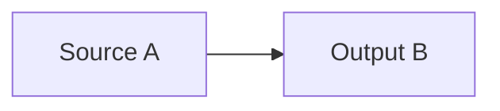

Cage:

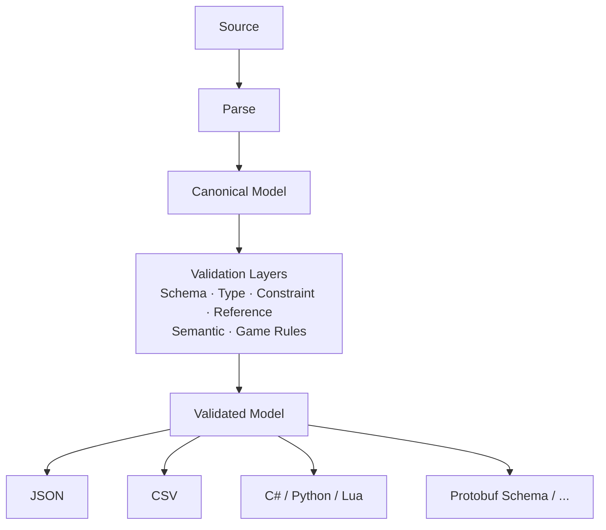

Beyond conversion, what Cage establishes is a configuration compilation chain: validation, cross-configuration references, normalization, and deterministic builds are all completed along this chain.

## Naming: The Casino Cage Metaphor

Cage is named after the **Cage / Cashier's Cage** in a casino.

In a casino, the Cage is:

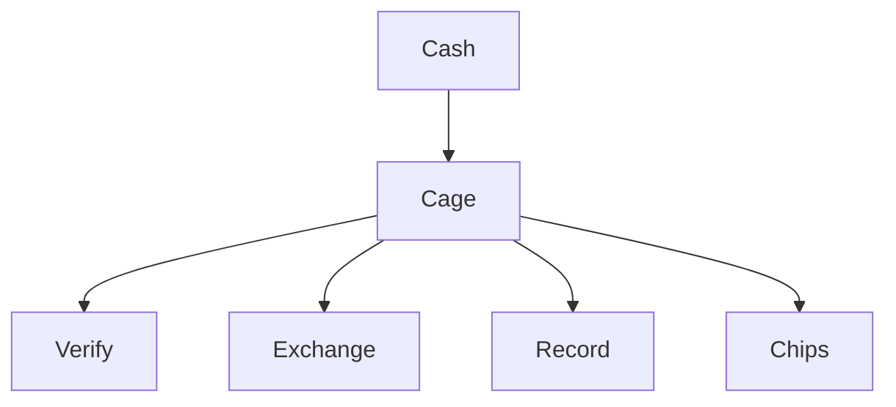

Cage:

```mermaid
flowchart TD
    D[Authoring Data] --> C
    subgraph C[Cage]
        direction LR
        P[Parse] --> V[Validate] --> N[Normalize] --> T[Transform] --> AU[Audit]
    end
    C --> R[Runtime Assets]
```

So it is more like the exchange-and-settlement boundary that configuration passes through before entering the runtime world:

The cage in a casino does not care whether you end up playing Poker, Blackjack, or Baccarat; likewise, Cage should not care whether the configuration ultimately serves Unity, Cocos, Unreal, a game server, or tools. It is only responsible for:

> **Input data must be valid, complete, and verifiable before it can be exchanged for runtime assets.**

## One-Sentence Definition

In English:

> **Cage is a configuration compiler and validation framework for game development. It transforms heterogeneous authoring data into validated, deterministic runtime artifacts.**

In Chinese:

> **Cage 是一个面向游戏研发的配置编译与验证框架，将异构的配置源转换为经过验证、确定性构建的运行时配置资产。**

## Core Design Principles

1. Do not bind to Excel
2. Decouple Source and Target
3. All input enters one unified Canonical Model
4. Separate Validation and Transformation
5. Schema owns structure
6. Reference owns cross-configuration relationships
7. Semantic Rules own composition logic
8. Plugin Validators own complex game business rules
9. Target Generators own output
10. Builds must be reproducible
11. Artifacts must be traceable
12. Diagnostics must be precise down to the Source Location
13. Client / Server use Profiles, not hardcoding
14. The Core binds to no specific game engine
15. Excel is just the first Source

## Final Architecture

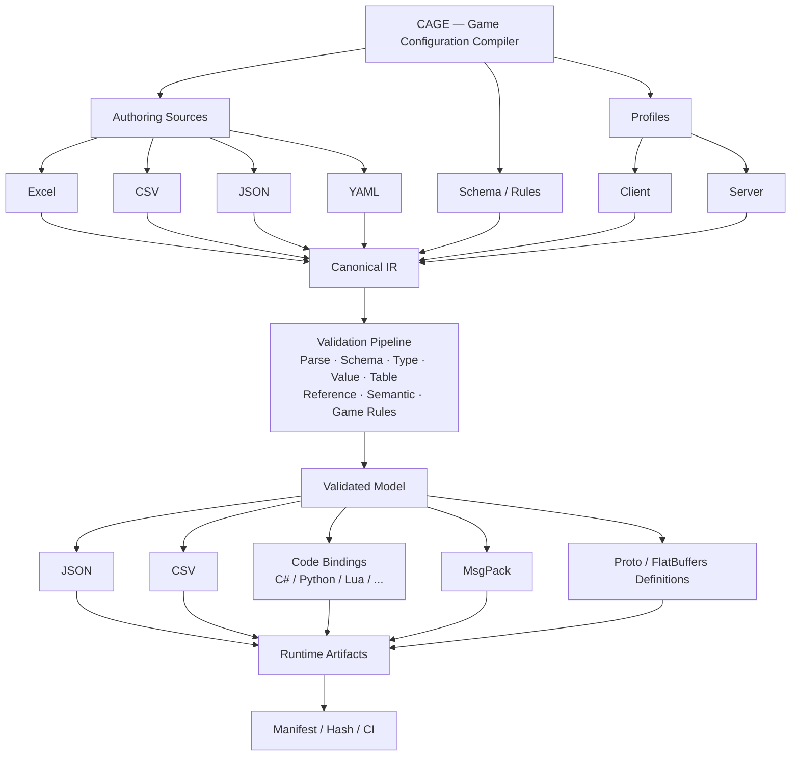

The general-purpose binary format (`Binary`) is still a planned item and is not within the currently supported `format =` range (the build rejects it with `unsupported target format` and exit code 2); the MsgPack data artifact and Protobuf (`.proto`) / FlatBuffers (`.fbs`) definition generation are implemented.

## The Core Beyond Source and Target

Cage's core abstraction is not the conversion between one pair of formats (`Excel → JSON`) but the chain in the middle:

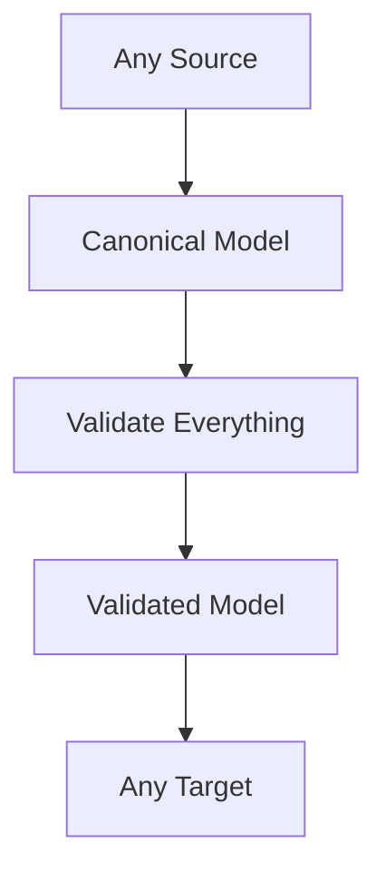

Excel, CSV, YAML, JSON, MySQL / PostgreSQL, HTTP API, and Google Sheets are just Sources; JSON, CSV, MsgPack, C#, Python, Lua, C++, Go, Java, Protobuf Schema, JSON Schema, and Template are just the already-implemented Targets.

What truly belongs to the Cage Core is this middle part:

> **Schema + Canonical Model + Reference Graph + Validation Pipeline + Semantic Rules + Deterministic Build**
