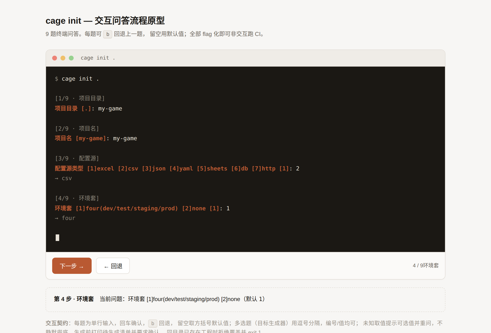
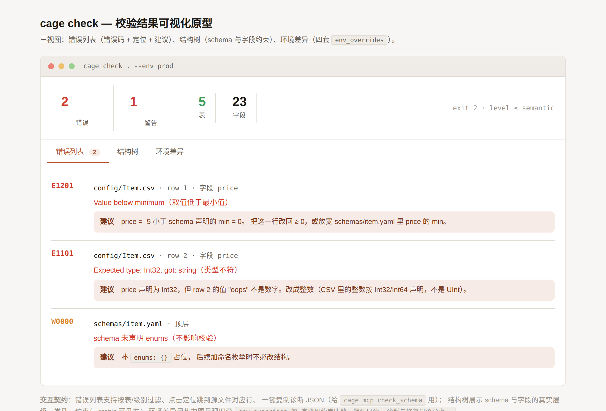
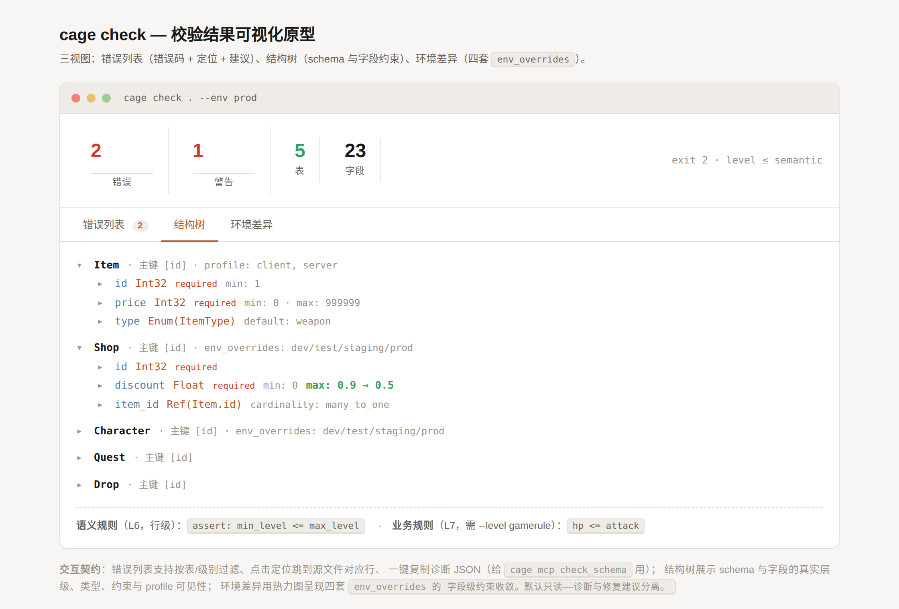
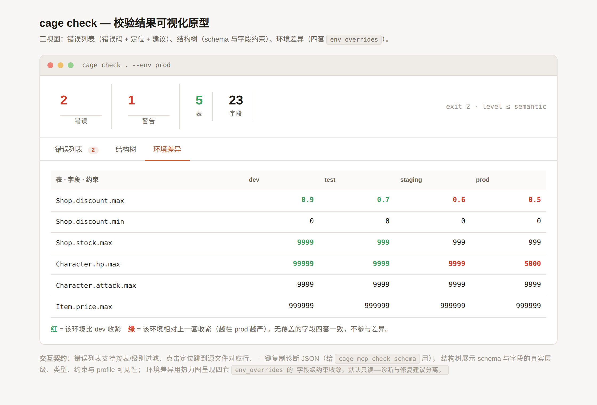

# UI Design Prototypes (Pending Review)

Two static HTML prototypes, design only, not wired to any code. **Implementation
starts only after this pending review passes.**

Sources live in `docs/design/` (this directory is committed with the repo; open it
in a browser directly and they are interactive):

- `docs/design/init-wizard.html` — the interactive `cage init` question flow
- `docs/design/validation-result.html` — configuration validation result visualization

## I. The `cage init` question flow

Nine terminal questions. Each step accepts `b` to go back to the previous question,
leaving the answer blank takes the bracketed default; once everything is a flag it
runs non-interactively in CI.

### Interaction contract

- Each question takes a single line of input, Enter confirms, `b` goes back, blank takes the default.
- Multi-select (target generators) uses comma separation; both numbering and values work.
- An unrecognized value lists the allowed values and re-asks — no silent fallback.
- Before generating, print the pending-artifact list and require confirmation.
- When a project already exists in the same directory, refuse to overwrite and exit 1 (never overwrite user data).

The order matches the current 9 questions in `crates/cage-cli/src/init.rs`:
project directory → project name → configuration source type → environment set →
target generators → template style → git init → include sample tables → confirm.

## II. Configuration validation result visualization

Three views: **error list** (error code + location + suggestion), **structure tree**
(schema and field constraints), **environment differences** (a convergence heatmap
of the four `env_overrides` sets).

### Interaction contract

- The error list supports filtering by table/level; clicking a location jumps to the matching line in the source file.
- One-click copy of the diagnostics JSON (isomorphic to what `cage mcp check_schema` returns, so it can be fed straight to an AI).
- The structure tree shows the real hierarchy of the schema and its fields, their types, constraints and profile visibility.
- Environment differences render the field-level constraint convergence of the four `env_overrides` sets as a heatmap (the closer to prod, the tighter).
- Read-only by default: diagnostics and fix suggestions are kept separate, data is not edited here.

The diagnostic data comes from real `cage check` output: E1201 (value below minimum),
E1101 (type mismatch), Shop.discount `max` across the four environments
0.9 → 0.7 → 0.6 → 0.5, `assert: min_level <= max_level` (L6) and `hp <= attack` (L7).

## III. Open decisions

1. Do we build a Web UI form (extending `/status/` of the existing `cage web`), or keep
   CLI + MCP as a dual front end and let Web only do the schema editor?
2. Does the structure tree need cross-table reference highlight linkage (click
   `Ref(Item.id)` to jump to the Item table)?
3. Does the environment difference heatmap need a "collapse adjacent environments with
   identical values" affordance (as when staging/prod agree)?
