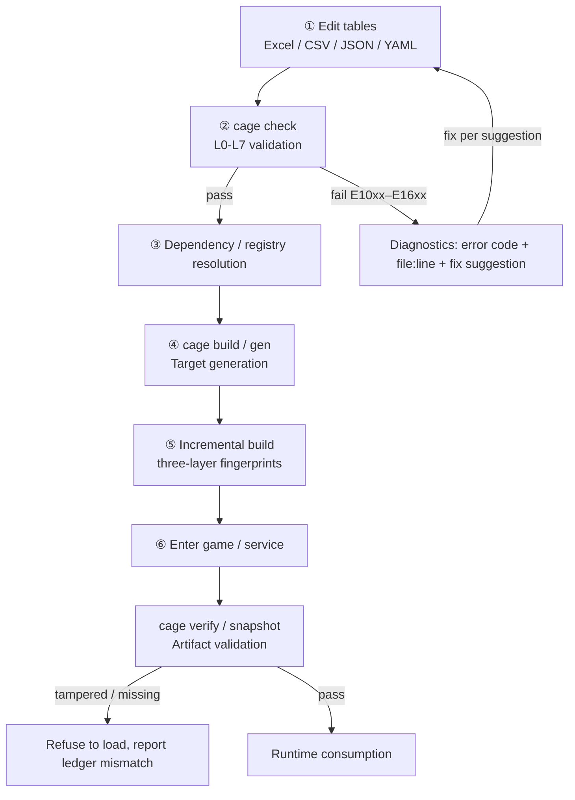
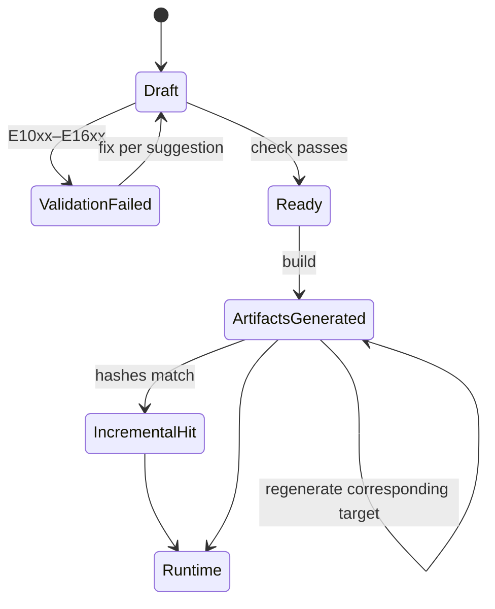

[中文](lifecycle.md) | English

# The Lifecycle of Game Configuration

A piece of configuration passes through only **cage's six stages** on its way
from a designer editing a table to the data entering the game. Every stage
has explicit state transitions, and failure branches return to the previous
stage carrying an error code — there is no in-between state of "edited, but
no idea whether it is right".

## Main Flow Diagram



## State Transitions



## Key Points in Text Form

1. **Edit tables**: designers change data in Excel / CSV / JSON / YAML, or
   change the structure in `schemas/*.yaml`. This step does not go through
   cage; it is purely manual.
2. **Validation**: `cage check` runs the eight-level pipeline from L0 Parse →
   L7 Game Rule. Failures return an error code (E10xx schema / E11xx types /
   E12xx values / E13xx tables / E14xx references / E15xx semantics / E16xx
   business rules) + a precise location (file / Sheet / cell / field / value)
   + a fix suggestion. **Run this step first after editing**; do not build
   directly.
3. **Dependency / registry resolution**: the `registry:<package>@<version>` entries
   declared under `[dependencies]` are resolved here; remote http(s) roots are
   fetched and cached, and remain usable offline.
4. **Target generation**: `cage build` / `cage gen` generate artifacts per
   profile — JSON / CSV / MessagePack / code bindings and more — while
   writing the Build Manifest (schema_hash / source_hash / content_hash /
   artifacts).
5. **Incremental build**: `cage build --incremental` decides from the
   manifest's three fingerprint layers — a schema change falls back to a full
   build, a source change regenerates the affected artifacts, and a target
   configuration change regenerates only the corresponding target. Validation
   still runs in full.
6. **Enter game / service**: `cage verify` validates the generated artifacts
   (or the self-verifying snapshot packaged by `cage snapshot`); verification
   happens before the server starts, and tampering / added-or-removed files
   are exposed immediately.

## Where Subcommands Sit in the Lifecycle

| Stage | Subcommand | Purpose |
| --- | --- | --- |
| Before ① | `cage init` | Scaffold a project skeleton (cage.toml + schema + sample data) |
| Before ① | `cage schema-draft` | Draft a schema by introspecting a legacy database (read-only MySQL / PostgreSQL) |
| ① → ② | `cage migrate` / `cage migrate-draft` | Migrate legacy data onto the current schema along the stepwise version chain |
| ② | `cage check` | Eight-level validation with structured diagnostics |
| ③ | `cage registry` | Publish / list / verify / clean up / distribute configuration packages |
| ④ | `cage build` / `cage gen` | Generate artifacts / code bindings |
| ⑤ | `cage build --incremental` | Three-layer incremental build |
| ⑥ | `cage verify` / `cage snapshot` | Artifact validation / self-verifying snapshot |
| Cross-cutting | `cage mcp` | AI assistant: wraps ② ④ ⑤ as MCP tools |
| Cross-cutting | `cage lsp` | IDE diagnostics (stdio Language Server) |
| Cross-cutting | `cage inspect` / `cage diff` / `cage graph` | Inspect structure / compare versions / dependency graph |
| Cross-cutting | `cage assets` | Asset inventory and baseline validation |
| Cross-cutting | `cage web` | Local service for the Schema editor |

## Scenarios

### Scenario 1: Day-to-day table iteration

```bash
cd examples/game-config
vim config/Item.csv            # 改一行价格
cage check . --env dev         # ② 校验
cage build . --env dev         # ④ 生成
```

Expected: `cage check` passes (or returns diagnostics carrying `file:row:col`);
`cage build` outputs `OK (profile 'client', N artifacts, manifest …/manifest.json)`.

### Scenario 2: Adding four environment sets

```bash
# schemas/shop.yaml 的 env_overrides 里声明 dev/test/staging/prod
cage check . --env prod        # 按 prod 约束验证
cage build . --env prod       # 按 prod 约束生成
cage mcp                       # 或让 AI 用 list_envs 看四套差异
```

Expected: `--env prod` applies the field constraints from `env_overrides.prod`
(e.g. `Shop.discount.max` tightens from 0.9 under dev to 0.5 under prod); an
undeclared environment name is a usage error (exit 2).

### Scenario 3: CI integration

```yaml
- run: cage check . --level semantic --env prod
- run: cage build . --env prod --incremental
- run: cage verify build/ --profile client
```

Expected: three sequential steps in CI — validation, incremental build,
artifact validation. Any failing step halts the run, and the diagnostics carry
error codes that can be pasted straight into an issue.

### Scenario 4: Remote registry dependency

```bash
# 消费方 cage.toml
[dependencies]
  shop = "registry:shop@1.2.0"

cage check .                    # ③ 解析并拉取 shop@1.2.0
cage build .                    # ④ 生成（含依赖表）
```

Expected: packages declared under `[dependencies]` are pulled from the
registry and cached; when offline, the cache is used, and `--no-cache` forces
the fallback to be refused.

### Scenario 5: Legacy-database migration, migrate draft → apply

```bash
cage schema-draft --db mysql://… --out schemas/legacy.yaml   # 内省起草
cage migrate-draft . --out migrations/v1.yaml                # 起草迁移链
cage migrate .                                               # 预演（不落盘）
cage migrate . --write                                       # 落盘 + 全栈回验
```

Expected: `migrate` reports each transformation step as a dry run by default;
`--write` writes only local text sources (JSON / YAML / CSV), Excel and
remote sources stay read-only reports, and after writing it runs the
full-stack L0–L6 re-verification.
