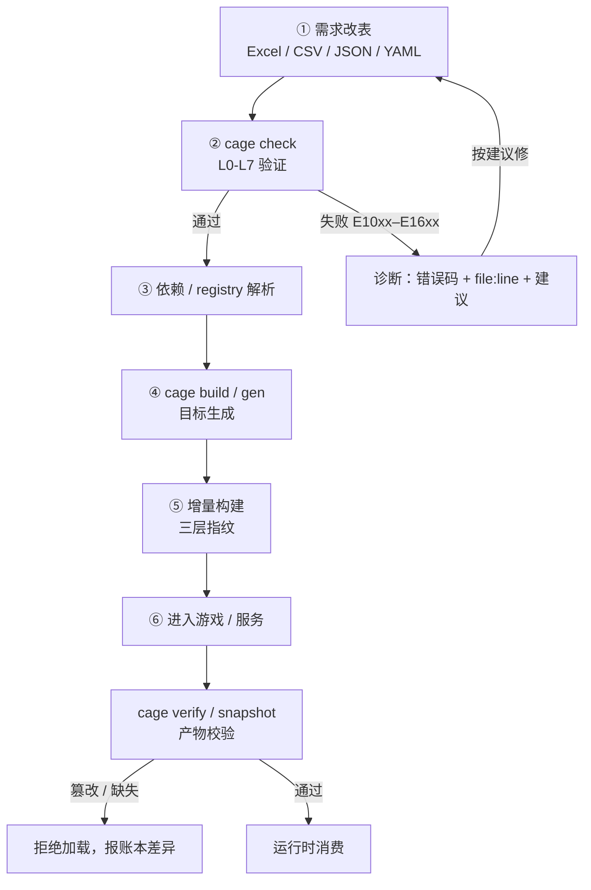
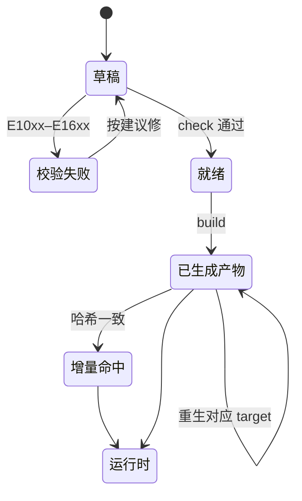

# 游戏配置的生命周期

一条配置从策划改表到进游戏，中间只经过 **cage 的六个阶段**。每个阶段都有
明确的状态流转，失败分支带着错误码回到上一个阶段——不存在"改完不知道
对不对"的中间态。

## 主流程图



## 状态流转



## 文字版要点

1. **需求改表**：策划在 Excel / CSV / JSON / YAML 里改数据，或在
   `schemas/*.yaml` 里改结构。这一步不经过 cage，是纯人工。
2. **校验**：`cage check` 跑 L0 Parse → L7 Game Rule 八级流水线。失败
   返回错误码（E10xx Schema / E11xx 类型 / E12xx 取值 / E13xx 表 /
   E14xx 引用 / E15xx 语义 / E16xx 业务规则）+ 精确定位（文件 / Sheet /
   单元格 / 字段 / 值）+ 修复建议。**改完先跑这一步**，不要直接构建。
3. **依赖 / registry 解析**：`[dependencies]` 声明的 `registry:包@版本`
   在此解析；远程 http(s) 根拉取并缓存，离线可用。
4. **目标生成**：`cage build` / `cage gen` 按 profile 生成 JSON / CSV /
   MessagePack / 代码绑定等产物，同时写 Build Manifest（schema_hash /
   source_hash / content_hash / artifacts）。
5. **增量构建**：`cage build --incremental` 按 manifest 三层指纹判断——
   schema 变化回退全量，source 变化重生受影响产物，target 配置变化只
   重生对应 target。校验仍全量执行。
6. **进入游戏 / 服务**：`cage verify` 校验已生成产物（或
   `cage snapshot` 打包的自校验快照），服务器启动前验证，篡改 / 增删
   文件即暴露。

## 子命令在生命周期中的位置

| 阶段 | 子命令 | 作用 |
| --- | --- | --- |
| ① 之前 | `cage init` | 起工程骨架（cage.toml + schema + 样例数据） |
| ① 之前 | `cage schema-draft` | 从历史库内省起草 schema（只读 MySQL / PostgreSQL） |
| ① → ② | `cage migrate` / `cage migrate-draft` | 按版本步进链迁移旧数据到当前 schema |
| ② | `cage check` | 八级验证，结构化诊断 |
| ③ | `cage registry` | 发布 / 列表 / 校验 / 清理 / 分发配置包 |
| ④ | `cage build` / `cage gen` | 生成产物 / 代码绑定 |
| ⑤ | `cage build --incremental` | 三层增量 |
| ⑥ | `cage verify` / `cage snapshot` | 产物校验 / 自校验快照 |
| 横切 | `cage mcp` | AI 助手：把 ②④⑤ 包成 MCP 工具 |
| 横切 | `cage lsp` | IDE 诊断（stdio Language Server） |
| 横切 | `cage inspect` / `cage diff` / `cage graph` | 结构查看 / 版本对比 / 依赖图 |
| 横切 | `cage assets` | 资产清单与基线校验 |
| 横切 | `cage web` | Schema 编辑器本地服务 |

## 场景

### 场景一：日常改表迭代

```bash
cd examples/game-config
vim config/Item.csv            # 改一行价格
cage check . --env dev         # ② 校验
cage build . --env dev         # ④ 生成
```

预期：`cage check` 通过（或返回带 `file:row:col` 的诊断）；`cage build`
输出 `OK (profile 'client', N artifacts, manifest …/manifest.json)`。

### 场景二：新增环境四套

```bash
# schemas/shop.yaml 的 env_overrides 里声明 dev/test/staging/prod
cage check . --env prod        # 按 prod 约束验证
cage build . --env prod       # 按 prod 约束生成
cage mcp                       # 或让 AI 用 list_envs 看四套差异
```

预期：`--env prod` 应用 `env_overrides.prod` 的字段约束（如
`Shop.discount.max` 从 dev 的 0.9 收到 prod 的 0.5）；未声明的环境名是
用法错误（exit 2）。

### 场景三：CI 集成

```yaml
- run: cage check . --level semantic --env prod
- run: cage build . --env prod --incremental
- run: cage verify build/ --profile client
```

预期：CI 里三步串行——校验、增量构建、产物校验。任一步失败即中断，
诊断带错误码可直接贴进 issue。

### 场景四：远程 registry 依赖

```bash
# 消费方 cage.toml
[dependencies]
  shop = "registry:shop@1.2.0"

cage check .                    # ③ 解析并拉取 shop@1.2.0
cage build .                    # ④ 生成（含依赖表）
```

预期：`[dependencies]` 声明的包从 registry 拉取并缓存；离线时用缓存，
`--no-cache` 可强制拒绝回退。

### 场景五：历史库迁移 migrate draft → apply

```bash
cage schema-draft . mysql:legacy_items                      # 内省起草（只读，绑定参数）
cage migrate-draft schemas/old.yaml schemas/new.yaml --from 1.0.0 --to 2.0.0   # 起草迁移规则稿
cage migrate .                                               # 预演（不落盘）
cage migrate . --write                                       # 落盘 + 全栈回验
```

预期：`migrate` 默认 dry-run 报告每一步变换；`--write` 只写本地文本源
（JSON / YAML / CSV），Excel 与远程源保持只读报告，写后跑 L0–L6 全栈
回验。
